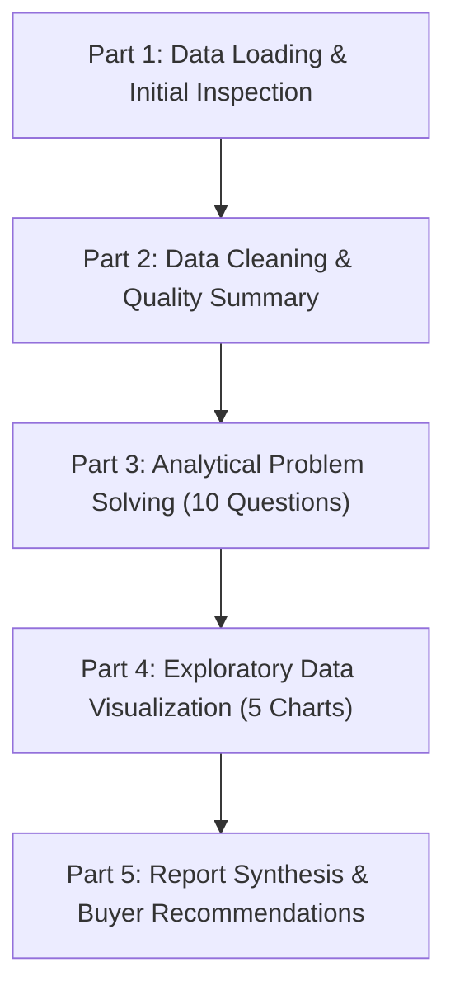

# Housing Price Analysis — Exploratory Data Analysis (EDA)


---

## Author
**Eberechi Bessie Donalds**  
Data Science Student, AltSchool Africa  
*1st Semester Capstone Project / Assessment*

---

## Executive Summary

This project conducts an in-depth **Exploratory Data Analysis (EDA)** on a housing dataset comprising 545 residential property records across 13 distinct features. The primary objective is to uncover structural patterns, identify the core physical and locational determinants of residential property valuation, examine market skewness and luxury outliers, and formulate practical, data-backed buying recommendations for cost-conscious property seekers.

### Key Takeaways:
- **Distribution Skewness:** House prices range from 1,750,000 to 13,300,000 with a mean of 4,766,729 and a median of 4,340,000. The distribution is distinctly right-skewed due to 15 high-value luxury outliers identified via Interquartile Range (IQR) analysis.
- **Top Price Drivers:** Air conditioning represents the single largest individual feature premium (+1,821,281 / ~43.4%), followed by main road accessibility (+1,592,873 / ~46.9%), full furnishing (+1,481,865 over unfurnished), and preferred neighborhood location (+1,453,747 / ~32.9%).
- **Space & Structure Dynamics:** Property area displays a moderate positive correlation with price ($r = 0.54$), while story height shows consistent monotonic price growth—4-storey homes average 7,208,450, nearly double the 4,170,659 average of single-storey units.
- **Strategic Buyer Recommendation:** Value-oriented buyers can achieve substantial savings by purchasing unfurnished, non-air-conditioned homes situated off main roads in non-preferred areas, retrofitting and personalizing amenities independently post-acquisition.

---

## Data Source & Limitations

### Data Provenance & Attribution
- **Raw Dataset Source:** Kaggle (`/kaggle/input/datasets/kryusufkaya/housing/Housing.csv`)
- **Dataset Curator / Uploader:** Şükrü Yusuf Kaya (`kryusufkaya`)
- **Repository Dataset File:** [`Housing.csv`](Housing.csv)

### Record Nature: Real-World vs. Synthetic Disclaimer
> **Disclaimer on Data Authenticity:**  
> Based on analysis of the data attributes, underlying distributions, and established data science benchmarks, this dataset represents **real-world observational property sales records** rather than randomly synthesized or algorithmically generated dummy data. The dataset exhibits authentic real-estate variance, including a genuine right-skewed price distribution, realistic spatial sizing, and 15 verifiable luxury outlier estates that mirror real-world market conditions.

### Analytical Limitations:
1. **Pre-Cleaned Completeness:** The raw dataset exhibits zero missing values and zero duplicate rows across all 545 entries, reflecting extensive upstream curation prior to distribution.
2. **Missing Currency and Spatial Metadata:** Column headers do not specify currency denominations or precise municipal coordinates beyond binary relative flags (`mainroad`, `prefarea`).
3. **Absence of Temporal Stamps:** The dataset lacks transaction timestamps, preventing longitudinal analysis of inflation, macro-interest rate cycles, or historical price appreciation.
4. **Sample Representation:** With a sample size of $N = 545$, certain extreme categories (e.g., 1-bedroom and 6-bedroom homes with only 2 records each; hot water heating with 25 records) provide limited statistical power for sub-segment generalization.
5. **Intended Use:** Findings and interpretations are structured for educational, exploratory, and comparative market evaluation. They do not constitute formal real estate appraisals or unhedged financial advice.

---

## Repository Structure

```text
.
├── Exploratory Data Analysis  (Housing) Report.pdf   # Formal academic summary report & recommendations
├── Housing.csv                                       # Source dataset (545 property records, 13 features)
├── MINI EDA PROJECT ON HOUSING PRICE ANALYSIS (1).ipynb # Full Jupyter Notebook with code, outputs & markdown interpretations
└── README.md                                         # GitHub project documentation
```

---

## Dataset Overview

The dataset consists of **545 rows** and **13 columns** with no missing entries and no duplicate rows.

### Column Specifications

| # | Feature | Data Type | Description | Observed Domain / Values |
|---|---|---|---|---|
| 1 | `price` | `int64` | Sale price of the property (target variable) | Min: 1,750,000 — Max: 13,300,000 |
| 2 | `area` | `int64` | Total property footprint (square feet) | Min: 1,650 — Max: 16,200 |
| 3 | `bedrooms` | `int64` | Number of bedrooms | 1 to 6 (Mode: 3 bedrooms, 55.0%) |
| 4 | `bathrooms` | `int64` | Number of bathrooms | 1 to 4 (Median: 1) |
| 5 | `stories` | `int64` | Number of stories/floors excluding basement | 1 to 4 (Median: 2) |
| 6 | `mainroad` | `object` | Connected to a primary road network | `yes` (468), `no` (77) |
| 7 | `guestroom` | `object` | Property includes a dedicated guestroom | `no` (448), `yes` (97) |
| 8 | `basement` | `object` | Presence of a basement | `no` (354), `yes` (191) |
| 9 | `hotwaterheating`| `object` | Equipped with hot water heating system | `no` (520), `yes` (25) |
| 10| `airconditioning`| `object` | Equipped with central air conditioning | `no` (373), `yes` (172) |
| 11| `parking` | `int64` | Dedicated parking spaces / stalls | 0 to 3 (Median: 0) |
| 12| `prefarea` | `object` | Situated in a designated preferred location | `no` (417), `yes` (128) |
| 13| `furnishingstatus`| `object`| Interior furnishing level | `semi-furnished` (227), `unfurnished` (178), `furnished` (140) |

### Baseline Summary Statistics

| Metric | Price | Area (sq ft) | Bedrooms | Bathrooms | Stories | Parking |
|---|---|---|---|---|---|---|
| **Mean** | 4,766,729 | 5,150.54 | 2.97 | 1.29 | 1.81 | 0.69 |
| **Median** | 4,340,000 | 4,600.00 | 3.00 | 1.00 | 2.00 | 0.00 |
| **Std Dev** | 1,870,440 | 2,170.14 | 0.74 | 0.50 | 0.87 | 0.86 |
| **Q1 (25%)** | 3,430,000 | 3,600.00 | 2.00 | 1.00 | 1.00 | 0.00 |
| **Q3 (75%)** | 5,740,000 | 6,360.00 | 3.00 | 2.00 | 2.00 | 1.00 |
| **Min** | 1,750,000 | 1,650.00 | 1.00 | 1.00 | 1.00 | 0.00 |
| **Max** | 13,300,000 | 16,200.00 | 6.00 | 4.00 | 4.00 | 3.00 |

---

## Methodology

The investigation was conducted across five sequential phases as specified by project requirements:



### 1. Data Loading & Initial Inspection
- Imported Python libraries: `pandas`, `numpy`, `matplotlib.pyplot`, and `seaborn`.
- Ingested [`Housing.csv`](Housing.csv) using `pd.read_csv`.
- Inspected dimensional shape (`545, 13`), confirmed data types, printed head records, and calculated non-parametric medians.

### 2. Data Cleaning & Quality Assurance
- **Missing Value Audit:** Ran `.isnull().sum()`; verified that zero missing entries exist across all columns (100% data completeness).
- **Duplicate Verification:** Checked `.duplicated().sum()`; confirmed all 545 rows are unique.
- **Categorical Integrity:** Confirmed binary columns contain strictly `yes` and `no`, and `furnishingstatus` contains strictly `furnished`, `semi-furnished`, and `unfurnished`.
- **Outlier Analysis via Interquartile Range (IQR):**
  - **Price Outliers:**
    $$\text{IQR}_{\text{price}} = Q_3 - Q_1 = 5,740,000 - 3,430,000 = 2,310,000$$
    $$\text{Upper Fence} = Q_3 + 1.5 \times \text{IQR} = 9,205,000$$
    *Result:* Identified **15 price outliers** priced above 9,205,000 (up to 13,300,000).
  - **Area Outliers:**
    $$\text{IQR}_{\text{area}} = Q_3 - Q_1 = 6,360 - 3,600 = 2,760\text{ sq ft}$$
    $$\text{Upper Fence} = Q_3 + 1.5 \times \text{IQR} = 10,500\text{ sq ft}$$
    *Result:* Identified **12 area outliers** exceeding 10,500 sq ft (up to 16,200 sq ft).
  - **Retention Decision:** These records represent genuine luxury estates and large properties rather than data transcription faults. They were intentionally preserved in the dataset, with their upward pull on parametric means explicitly noted.

### 3. Analytical Problem Solving (10 Analytical Questions)
Formulated targeted aggregations, grouping functions, and correlation computations to answer 10 specific business and economic inquiries.

### 4. Data Visualizations
Constructed 5 clean statistical plots with standardized titles, explicit axis formatting (disabling raw scientific notation), and grid styling:
1. **Histogram:** Right-skewed distribution of property prices (30 bins).
2. **Scatter Plot:** Property area vs. price with hue encoding across furnishing levels.
3. **Box Plot:** Price spread comparing air-conditioned vs. non-air-conditioned homes.
4. **Bar Chart:** Mean property price segmented by bedroom count.
5. **Correlation Heatmap:** Annotated Pearson correlation matrix across all numeric metrics.

### 5. Report Synthesis
Compiled findings into a formal 3-page summary report ([`Exploratory Data Analysis  (Housing) Report.pdf`](Exploratory%20Data%20Analysis%20%20(Housing)%20Report.pdf)) providing strategic buying advice.

---

## Key Findings

### 1. Price Distribution & Measure of Central Tendency
- **Mean Price:** 4,766,729
- **Median Price:** 4,340,000
- **Maximum Price:** 13,300,000
- **Interpretation:** The mean exceeds the median by over 426,000, confirming positive right-skewness driven by the 15 upper luxury outliers (> 9,205,000). The **median is the superior measure of central tendency** for a typical property in this market.

### 2. Area vs. Price Correlation
- **Correlation Coefficient ($r$):** `0.5360` (Moderate positive correlation)
- **Interpretation:** As property area increases, sale price increases moderately. However, area alone accounts for only part of price variation; premium amenities and location contribute heavily.

### 3. Profile of the Top 5 Most Expensive Properties
The 5 highest-priced homes range from 11,410,000 to 13,300,000 and exhibit distinct structural convergence:
- **100% (5 of 5)** are situated on the main road.
- **80% (4 of 5)** feature central air conditioning.
- **80% (4 of 5)** are fully furnished.
- **80% (4 of 5)** have 4 bedrooms, and all have multiple stories (2 to 4 stories).

### 4. Main Road Access Premium
- **Main Road Average Price:** 4,991,777
- **Non-Main Road Average Price:** 3,398,905
- **Net Price Premium:** **1,592,873 (~46.9% increase)**
- **Interpretation:** Accessibility and direct road connection are major drivers of real estate valuation.

### 5. Air Conditioning Price Impact
- **With Air Conditioning:** 6,013,221
- **Without Air Conditioning:** 4,191,940
- **Net Price Premium:** **1,821,281 (~43.4% increase)**
- **Interpretation:** Air conditioning is the **single largest standalone amenity price driver** in the dataset, commanding a larger absolute dollar premium than main road placement.

### 6. Furnishing Status Ranking
Furnishing level exhibits a clear hierarchical price structure:
1. **Furnished:** 5,495,696 *(Highest)*
2. **Semi-Furnished:** 4,907,524
3. **Unfurnished:** 4,013,831
- **Net Difference:** Fully furnished homes cost **1,481,865 more** than unfurnished properties.

### 7. Preferred Neighborhood (`prefarea`) Premium
- **Preferred Area Average:** 5,879,046
- **Non-Preferred Area Average:** 4,425,299
- **Net Price Premium:** **1,453,747 (~32.9% increase)**

### 8. Bedroom Market Share & Distribution
- **Mode:** 3 bedrooms (300 out of 545 homes = **55.0%** of the entire market).
- **2 Bedrooms:** 136 homes (25.0%).
- **4 Bedrooms:** 95 homes (17.4%).
- **5 Bedrooms:** 10 homes (1.8%).
- **1 & 6 Bedrooms:** 2 homes each (0.4%).
- **Interpretation:** The market is heavily dominated by 3-bedroom, mid-sized family properties.

### 9. High-Value Amenity Combination (Basement + Air Conditioning)
- Exactly **66 properties** possess both a basement and air conditioning.
- **Combined Average Price:** **6,081,197**
- **Interpretation:** These dual-amenity homes command a 27.6% premium over the market average (4,766,729), indicating that compounding amenities create disproportionately high valuations.

### 10. Vertical Expansion (Stories vs. Price)
Price scales monotonically with the number of stories:
- **1 Story:** 4,170,659
- **2 Stories:** 4,764,074
- **3 Stories:** 5,685,436
- **4 Stories:** 7,208,450
- **Interpretation:** 4-storey properties average nearly double the price of single-storey units (+72.8%), reflecting both increased floor space and architectural prestige.

### 11. Numeric Feature Correlation Hierarchy with Price
From the numeric correlation matrix heatmap:
1. **Area:** $r = 0.54$ (Strongest numeric predictor)
2. **Bathrooms:** $r = 0.52$
3. **Stories:** $r = 0.42$
4. **Parking:** $r = 0.38$
5. **Bedrooms:** $r = 0.37$ (Weakest correlation among physical dimensions, demonstrating that bathroom count, vertical stories, and square footage matter more than bedroom count alone).

---

## Practical Recommendations for Value-Seeking Home Buyers

Derived from the analytical findings in the project report:

1. **Avoid Pre-Installed Air Conditioning — Retrofit Post-Purchase:**  
   Pre-installed AC inflates property purchase prices by an average of 1,821,281. Buyers can purchase non-AC properties and install high-efficiency units independently for a fraction of that premium, unlocking immediate equity.
2. **Consider Properties Off the Main Road:**  
   Properties off the main road are priced approximately 47% lower (1,592,873 savings) while frequently offering comparable residential space, reduced noise levels, and equivalent access to neighborhood services.
3. **Select Unfurnished Homes and Furnish Independently:**  
   Fully furnished homes demand a 1,481,865 premium over unfurnished properties. Buying unfurnished allows owners to customize interiors to personal standards at significantly lower retail expenditures.

---

## Tech Stack

- **Language:** Python (3.10+)
- **Data Manipulation:** `pandas`
- **Numerical Computations:** `numpy`
- **Data Visualizations:** `matplotlib`, `seaborn`
- **Development Environment:** Jupyter Notebook / Kaggle Notebook

---

## How to Run It

### 1. Prerequisites
Ensure you have Python 3.8+ installed on your system.

### 2. Clone or Download the Repository
```bash
git clone https://github.com/<your-username>/<your-repo-name>.git
cd <your-repo-name>
```

### 3. Create and Activate a Virtual Environment
- **On Windows (PowerShell):**
  ```powershell
  python -m venv venv
  .\venv\Scripts\Activate.ps1
  ```
- **On macOS/Linux:**
  ```bash
  python3 -m venv venv
  source venv/bin/activate
  ```

### 4. Install Dependencies
Install the required analytical and visualization packages:
```bash
pip install pandas numpy matplotlib seaborn notebook
```

### 5. Launch the Notebook
Run the Jupyter Notebook server:
```bash
jupyter notebook "MINI EDA PROJECT ON HOUSING PRICE ANALYSIS (1).ipynb"
```

> **Note on Data Path:**  
> The original notebook was executed in Kaggle using `/kaggle/input/datasets/kryusufkaya/housing/Housing.csv`. When running locally, ensure [`Housing.csv`](Housing.csv) is located in the working directory and load it directly via:
> ```python
> df = pd.read_csv("Housing.csv")
> ```

---

## Author Info

- **Author:** Eberechi Bessie Donalds
- **Institution:** AltSchool Africa
- **Program:** Data Science
- **Project:** 1st Semester Capstone Project / Assessment
